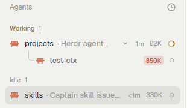

# Agents context

The Herdr agents list, with one more value on each agent row: the context size of that agent's
session. Nested `hc` crewmates show it too. Normally the value is a dim token number at the row
end, for example `82K`. Near the end of the context window, the number moves into a small
red-tinted badge. Rows do not get taller. A row without data shows nothing.

## What you see

The same agents list as the shipped `agents` mod (left sidebar, under Spaces). Each agent row and
each nested crewmate row has one more element, directly before the status mark (spinner, ring,
dot, or "Needs you"):

- **Normal:** the token count as text. Size 10.5px, color `theme().dim`. Format: `950` below 1000,
  `82K` (rounded thousands) from 1000, `1.2M` (one decimal) from 999,500 (so never `1000K`).
- **Warning:** from `WINDOW_MARGIN = 0.8` of the window (800K on a 1M window). The same number in
  a badge: 15px high, 4px side padding, radius 4, background `theme().blocked + "26"`, text 10px
  semibold in `theme().blocked`.
- **No data:** no element. This applies to a terminal that never ran Claude Code with the writer
  (a plain shell, Pi, Codex). A terminal that ran Claude Code earlier keeps its last value: see
  Watch out.

In a crewmate row, the value has a 6px right margin before the status mark. In an agent row, the
row's own spacing applies. When the sidebar is collapsed (narrow), rows show no value.

## How it behaves

- Hover over the value: a tooltip `Context 82K / 1.0M (8%)`. On the badge, the tooltip also has
  ` · near compaction (from 800K)`.
- The value changes when the session's status line runs again. It does not change on its own
  timer.
- Agent status (working, blocked, done, idle), clicks, pins, sorting, folding, and the age text
  stay exactly as in the shipped `agents` mod. The value does not react to clicks.
- The window size comes from the label, per session. Do not use a fixed table: Haiku reports a
  1M window on some setups.

## Built from

- **Mod:** a `mod.clone` of the shipped `agents` mod, named `agents-context`
  (`herdr-app do mod.clone '{"name":"agents","as":"agents-context"}'`). This build is from
  `cloned_from: {name: "agents", version: "0.1.13"}`. All added code has a `CONTEXT` comment:
  - module level: `WINDOW_MARGIN`, `ctxOf(k)` (parses the label `usage.ctx` =
    `<used>/<size>` from a `terminals()` record; null when absent, malformed, or size 0),
    `short(n)`, `tip(c)`;
  - method `usage(t, k, kind)`: returns the badge, the dim text, or null. `kind` is `"ag"` or
    `"sub"` and goes into the element id `ctx-<kind>-<address>`;
  - `subRow`: adds `.children([this.usage(t, k, "sub")].filter(Boolean).map((u) => div().mr(6).child(u)))`
    before `this.status(...)`;
  - `render`: `termOf`, a map from address to `terminals()` record, built from `all` before
    `row`. Agent rows come from `agents()`, which has no labels, so `row` looks up
    `termOf.get(a.address)` and adds `.children([this.usage(t, termOf.get(a.address), "ag")].filter(Boolean))`
    before `this.status(...)`.
- **Layout:** a `layout.clone` of `main`, named `main-context`. Only its `agents` block changes:
  `"content": { "mod": "agents-context" }`.
- **Writer:** `statusline/context-label.sh`, pasted into the Claude Code status-line script. It
  reads `.context_window.total_input_tokens` and `.context_window.context_window_size` from the
  status-line JSON. When `HC_TERMINAL_ID` is set, it runs
  `hc label "$HC_TERMINAL_ID" usage.ctx=<used>/<size>` in the background. It keeps the last value
  in `$XDG_RUNTIME_DIR/herdr-agent-context.<terminal>` (`/tmp/...` when `XDG_RUNTIME_DIR` is
  unset) and writes the label only when the value changes.
- **Programs:** the writer runs `jq` and `hc`. The mod runs no programs, reads no files, and does
  not reach the network.

## Watch out

- `agents()` lists only agents that have a pane. `hc run` crewmates have no pane. The shipped mod
  nests them through `tree()` over `terminals()`, so `subRow` already gets the terminal record.
  Do not build crewmate rows from `agents()`.
- `mod.clone` renames the self-opening `openOverlay` mod name (the sort menu) to the new name.
  That is correct.
- `0.8` is a chosen margin, not a measured fact. Per the Claude Code docs (model-config and
  env-vars pages, read 2026-11-07): Claude Code compacts at the window limit by default (about
  967K on 1M models), and `CLAUDE_CODE_AUTO_COMPACT_WINDOW` and
  `CLAUDE_AUTOCOMPACT_PCT_OVERRIDE` change that. The status-line JSON has no compaction field.
  Check these again before you change the margin.
- The label stays on the terminal after Claude Code exits. The mod does not know which program
  wrote it. So a terminal that ran Claude Code earlier shows the old value on a later Pi or
  Codex agent, and on a new Claude Code session before its first refresh.
  `hc label <terminal> usage.ctx=` removes the label.
- `.child()` does not accept `null`, so add the optional value with `.children([...].filter(Boolean))`
  (or `.when`). The value needs `.id()`, because the tooltip needs an id.
- A crewmate that has its own pane shows as a top row and as a nested row. The `kind` part of
  the id keeps the two ids apart.
- A label change shows on the next render. A `herdr-app shot` directly after `hc label` can show
  the old value. A mod save reloads the mod and resets its in-memory state.
- Clones never update. After Herdr updates the shipped `agents` mod, clone it again and apply the
  `CONTEXT` changes from this recipe. Then update `cloned_from.version` here.
- Remote machines (`vps/t7` addresses) are not tested.

## Done when

- `herdr-app check <path to mods/agents-context>` passes.
- With layout `main-context`, a Claude Code agent row shows a dim token number after its first
  status-line refresh. The number matches `hc get <terminal>` → `labels["usage.ctx"]`.
- A crewmate from `hc run --bg --label crew.captain=<captain> -- claude --model haiku -- 'Reply OK only.'`
  shows its own dim number in its nested row.
- `hc label <crewmate> usage.ctx=850000/1000000` (a fake value) turns that row's value into the
  red badge `850K`. Its tooltip ends with `near compaction (from 800K)`.
- No row is taller than in the shipped `agents` mod, in a light theme (`paper`) and in a dark
  theme (`graphite`).
- A terminal without the label (a plain shell, Pi, Codex that never ran Claude Code) shows no
  value.
